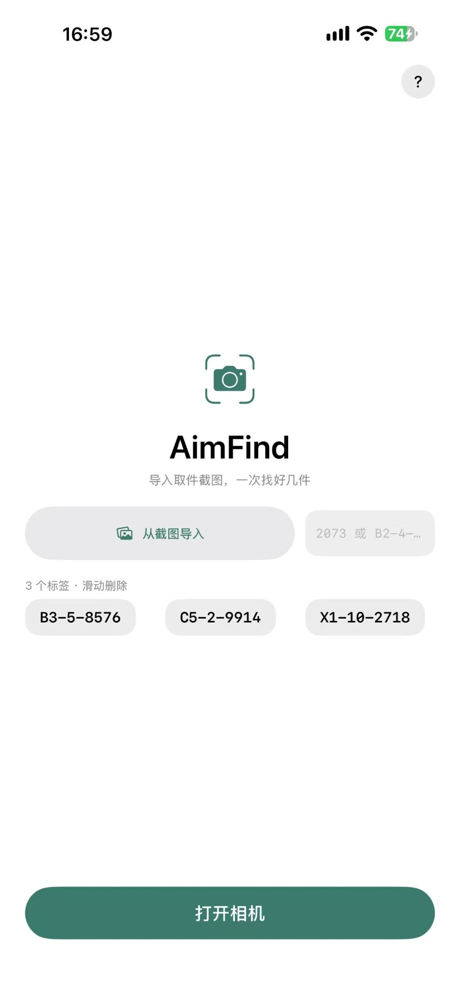
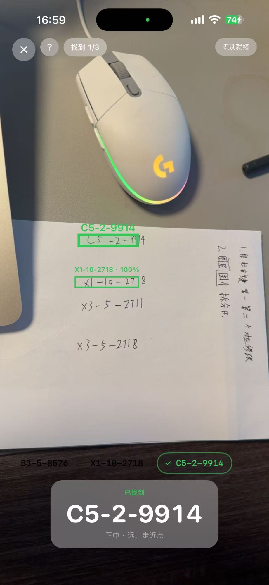

# AimFind

**在驿站货架前，用相机找出你那几件快递。**

取件通知写着「B2-4-2073」，货架上几十件包裹都印着同样醒目的 4 位数字，只能一件件抬头比对。
AimFind 把这件事变成：**把通知截图丢进 App，举起手机慢慢扫，要找的那几件直接框出来。**

<p align="center">
  
  
</p>

## 它做什么

- **截图变标签**：选取件通知截图（可多选），读出「货架-层-尾号」做成标签；也能手输
- **一次找好几件**：3–4 个标签一起带进取景，扫到哪个标哪个，顶部显示 `找到 1/3`
- **标位 + 方位**：绿框圈出那件，底部大字显示码和远近（`正中 · 远，走近点`）
- **自动合焦**：镜头对到识别出的那一点上，远处小标签更看得清
- **分清「还没扫到」和「这层没有」**：不让你原地反复扫
- 滑动删标签、相机页屏幕常亮、记住上次那批标签

不联网、不上传截图、无账号、无历史记录。全程 Apple 系统文字识别：**零第三方依赖，包体 2.1MB。**
不是条码/二维码扫描器 —— 印成条码的，手机自带相机更快。

## 三步上手

1. 首页点「从截图导入」，选取件通知截图（或手输 `2073` / `B2-4-2073`）
2. 标签墙里左右滑动删除多余的
3. 点「打开相机」，对着货架**慢慢横向平移**，停半秒等它确认

App 内右上角「?」是完整使用说明，与 [docs/USAGE.md](docs/USAGE.md) 同源。

## 怎么做到"不误读"

取件码有语法：`货架-层-尾号(恰好 4 位数字)`。把"识别对了"变成"匹配上语法"，准确率就成了可验证的规则问题。三条保守规则，各有单测钉住：

1. **只做 token 边界匹配，绝不子串匹配** —— 运单号 `YT8747063366760` 的结尾就是 `6760`，子串匹配会让每个运单号都误命中
2. **只在解释唯一时才修正混淆字符**，二义就判"没读到"；**从不猜测货架/层** —— 标错层会让人拿错件
3. **尊重 OCR 的分隔符切分** —— 不把 `B2-4-20731`（超长）"救"成 `B2-4-2073`

设计过程、被样本推翻的规则、路线取舍见 [docs/CODE_READING.md](docs/CODE_READING.md)。

## 架构

```
截图 ──► VisionTextReader ──► CodeGrammar / CodeInbox ──► 标签
相机帧 ─► 帧闸(≤12fps) ─► TargetMatcher ─► 3 帧稳定 ─► 标位 + 合焦 + 触觉
                                   └─ ShelfCensus → "没扫到" vs "这层没有"
```

读取引擎不认识语义，语义层不碰相机 —— `iPhone/Code/` 里几乎全是纯函数，测试不需要相机或模拟器。

## 开发

```sh
swift test                              # 47 条纯逻辑测试，无需 Xcode / 模拟器
xcodegen generate && open AimFind.xcodeproj   # 构建（相机链路需真机）
```

SwiftUI / iOS 17+ / Swift 5.10 / **无第三方依赖**。工程由 XcodeGen 生成（`project.yml` 是事实源，不提交 `.xcodeproj`）。
真机构建时临时传 `DEVELOPMENT_TEAM`（仓库故意留空）与常见问题见 [docs/BUILD.md](docs/BUILD.md)。

## 许可证

MIT（见 [LICENSE](LICENSE)）。两点请注意：

- **接第三方模型要看清许可** —— ultralytics 的 v5/v8/v11 权重是 **AGPL-3.0**，放进本 MIT 仓库或闭源 App 都冲突。出路：换 Apache-2.0 的检测模型（YOLOX 等）、整体改 AGPL、或让使用者自备模型。
- **开源许可 ≠ 苹果分发许可** —— 装到别人手机（TestFlight / App Store）仍需你自己的 Apple Developer 账号，本仓库不含证书。
